Software engineering student at the University of Duisburg-Essen, based in Bochum, Germany.
I build full-stack web applications, with a focus on backend.

**Open to working student and internship roles.**

## Projects

- **Life Board** — multi-user personal dashboard for money and side projects.
  React, TypeScript, Hono on Cloudflare Pages Functions, D1 + Drizzle, Supabase Auth.
- **Multiplayer Trading Card Game** — real-time PvP card game, team of 3. I built game-state
  sync, authentication, and session handling. Angular, Spring Boot, WebSockets.

## Stack

  
  
  
  
  
  
  
  
  
  
  
  

## Languages

Arabic (native) · German (C1) · English (professional)

## Contact

[Portfolio](https://mohammedwishah.com) · [LinkedIn](https://www.linkedin.com/in/mohammed-wishah-633043241/) · mr0wishah@gmail.com
